  

  

  
  
  

---

### About me

- 🎓 Computer Science grad student at Northeastern University
- 🛠️ Software Engineer Intern at MundoPrints (Summer 2026): built an LLM-powered instant-quote feature and a RAG chatbot grounded in catalog and policy data
- 📊 Previously Analytics Manager at HSBC
- 🤖 Into AI systems, data engineering, automation, and full-stack development
- ♟️ Competitive chess player since my school tournament days

### What I'm working on

- **AgentWatch** finds whether an LLM coding agent is slow because of the GPU, the CPU, or retrieval, and shows it run by run.
- **TrustLens** checks AI-generated answers against their sources and flags claims as supported, contradicted, or lacking evidence (I lead model evaluation).

### Featured projects

| Project | What it does | Built with |
|---|---|---|
| [**AgentWatch**](https://github.com/all3n2601/AgentWatch) | **Why is my AI agent slow?** An ML pipeline that diagnoses every slow step of an LLM coding agent and blames the real bottleneck: GPU inference, a CPU sandbox, or retrieval. LightGBM models beat the rule-based baseline by 10 points, reach 95% clean-run specificity, and attribute a slowdown within ~15 s. | Python · Go · OpenTelemetry · Prometheus · NVIDIA DCGM · LightGBM · MLflow · Airflow · DVC · FastAPI · PostgreSQL · Next.js · Docker · GKE |
| [**Country Topics**](https://github.com/benoyj20/Country-Topics-Platform) | **A knowledge site where every claim shows its evidence.** Topics are backed by timestamped YouTube clips, transcripts, and references whose DOI, ISBN, or link is verified before publishing. Includes full-text search, moderated discussion, a 2FA admin panel, daily backups, and k6 load tests. | TypeScript · Next.js · React · Payload CMS · PostgreSQL · BullMQ · Valkey · Cloudflare Workers + R2 · Docker · Sentry · Vitest · k6 |
| [**Kitchen version control**](https://github.com/benoyj20/Object-History-Tracking-With-Computer-Vision) | **Git-style history for a shared kitchen counter.** Snap phone photos from any angle and it records what was added, moved, or removed, and when. My fine-tuned YOLO26 detector finds 96% of objects on held-out photos, and a Claude assistant (in progress) will answer questions like *"where is the knife?"* | Python · PyTorch · Ultralytics YOLO26 · CUDA · CLIP · SQLite · FastAPI · Next.js · Claude API |
| [**Calendar app**](https://github.com/benoyj20/my-calendar-app) | **Scheduling across time zones, done right.** Multiple calendars, recurring events, and copying between calendars with automatic time-zone conversion, plus export to Google Calendar (iCal/CSV). Runs as a Swing GUI, an interactive CLI, or a headless script. | Java 11 · Swing · MVC + Command pattern · Gradle · JUnit · JaCoCo · PIT mutation testing |

### Tools I use

**Languages** 

**AI and machine learning** 

**Web and APIs** 

**Databases** 

**Cloud and DevOps** 

### Contributions

<picture>
  <source media="(prefers-color-scheme: dark)" srcset="https://raw.githubusercontent.com/benoyj20/benoyj20/output/github-snake-dark.svg">
  <source media="(prefers-color-scheme: light)" srcset="https://raw.githubusercontent.com/benoyj20/benoyj20/output/github-snake.svg">
  
</picture>
