  

  

  

  
  
  

---

### About me

> **Portfolio:** [see my work →](https://benoy-joseph.vercel.app)

- 🎓 Computer Science grad student at Northeastern University
- 🛠️ Software Engineer Intern at MundoPrints (Summer 2026): built an LLM-powered instant-quote feature and a RAG chatbot grounded in catalog and policy data
- 💼 Analytics Manager at HSBC (2024–25): built a React marketplace for internal automation tools that doubled adoption, and automated workflows across 10+ projects with Python and Alteryx, saving ~1,000 hours a year
- 🏆 1st place, Evidence Navigator track at the AI Healthcare Hackathon at Northeastern (Nov 2026), with [SecondOpinion](https://github.com/benoyj20/SecondOpinion), a fact-checker for cancer research reports
- 🥇 1st place at the Death Clock Hackathon, hosted by Google Developer Student Club, VIT Chennai (2023), a challenge spanning UI/UX design, web development, and machine learning

### What I'm working on

- **AgentWatch** finds whether an LLM coding agent is slow because of the GPU, the CPU, or retrieval, and shows it run by run.
- **TrustLens** checks AI-generated answers against their sources and flags claims as supported, contradicted, or lacking evidence (I lead model evaluation).

### Featured projects

| Project | What it does | Built with |
|---|---|---|
| [**AgentWatch**](https://github.com/all3n2601/AgentWatch) | **Why is my AI coding agent slow?** Watches every step of an LLM coding agent and pins each slowdown on its real cause: GPU inference, the CPU sandbox, or retrieval. **Result:** LightGBM models beat the rule-based baseline by 10 points, stay quiet on 95% of healthy runs, and name the culprit within ~15 s. | Python · Go · OpenTelemetry · Prometheus · NVIDIA DCGM · LightGBM · MLflow · Airflow · DVC · FastAPI · PostgreSQL · Next.js · Docker · GKE |
| [**SecondOpinion**](https://github.com/benoyj20/SecondOpinion) | **🏆 1st place: a fact-checker for cancer research reports.** Recounts every figure in a report against the real patient data, shows its working, and rewrites each claim to say what the data actually supports. **How:** deterministic pandas code decides every verdict (not an LLM), each count is redone eight ways to test whether it holds, and a person signs off before export. 1,500+ tests. Evidence Navigator track, AI Healthcare Hackathon at Northeastern, Nov 2026 | Python · pandas · FastAPI · TypeScript · Next.js · React · Tailwind CSS · pytest · Vitest · LLM |
| [**Kitchen version control**](https://github.com/benoyj20/Object-History-Tracking-With-Computer-Vision) | **Git-style history for a shared kitchen counter.** Snap phone photos from any angle and it logs what was added, moved, or removed, and when. **Result:** my fine-tuned YOLO26 detector finds 96% of objects in held-out photos. Next up: a Claude assistant that answers *"where's the knife?"* | Python · PyTorch · Ultralytics YOLO26 · CUDA · CLIP · SQLite · FastAPI · Next.js · Claude API |
| [**Calendar app**](https://github.com/benoyj20/my-calendar-app) | **Scheduling across time zones, done right.** Multiple calendars and recurring events, copying between calendars with automatic time-zone conversion, and export to Google Calendar (iCal/CSV). **Design:** one MVC core runs as a Swing GUI, an interactive CLI, or a headless script, verified with JUnit and PIT mutation testing. | Java 11 · Swing · MVC + Command pattern · Gradle · JUnit · JaCoCo · PIT mutation testing |

### Tools I use

**Languages** 
 
Python · Java · TypeScript · JavaScript · Go · C · C++ · R · Bash · HTML · CSS

**AI, machine learning, and MLOps** 
 
PyTorch · TensorFlow · scikit-learn · Apache Airflow · MLflow

**Web and APIs** 
 
React · Next.js · Node.js · Express · FastAPI · Tailwind CSS · Vite · PHP

**Databases** 
 
PostgreSQL · MySQL · MongoDB · SQLite

**Cloud and DevOps** 
 
AWS · Azure · Google Cloud · Cloudflare · Terraform · Docker · Kubernetes · GitHub Actions · Prometheus · Linux · Git · GitHub

### Contributions

<picture>
  <source media="(prefers-color-scheme: dark)" srcset="https://raw.githubusercontent.com/benoyj20/benoyj20/output/github-snake-dark.svg">
  <source media="(prefers-color-scheme: light)" srcset="https://raw.githubusercontent.com/benoyj20/benoyj20/output/github-snake.svg">
  
</picture>
